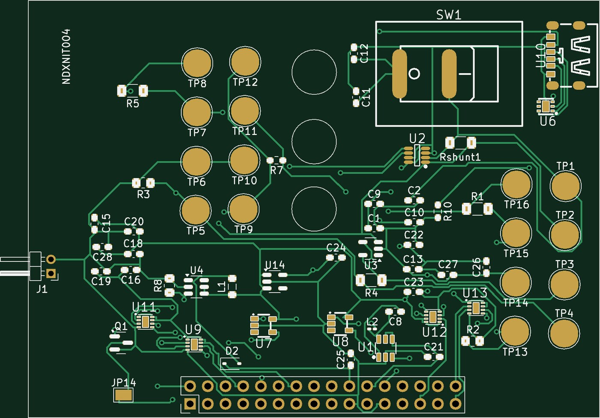
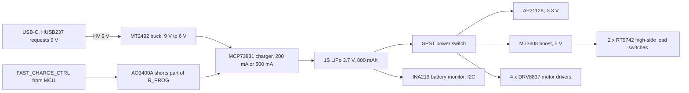
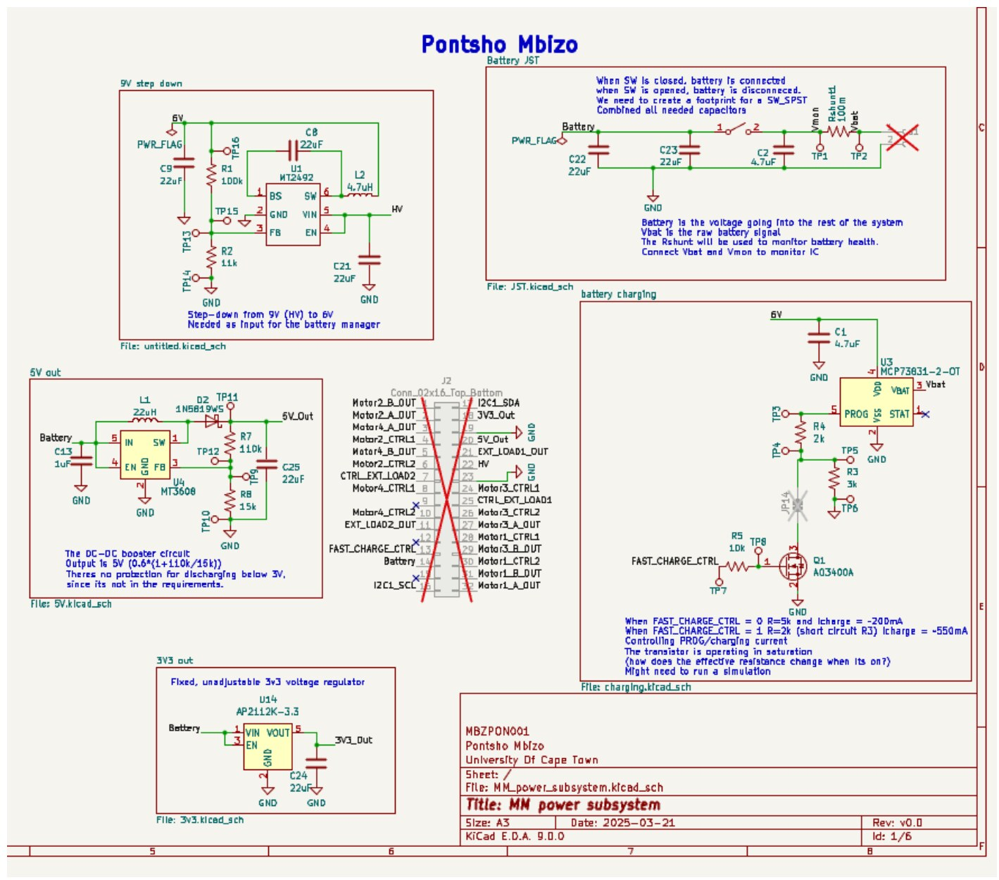
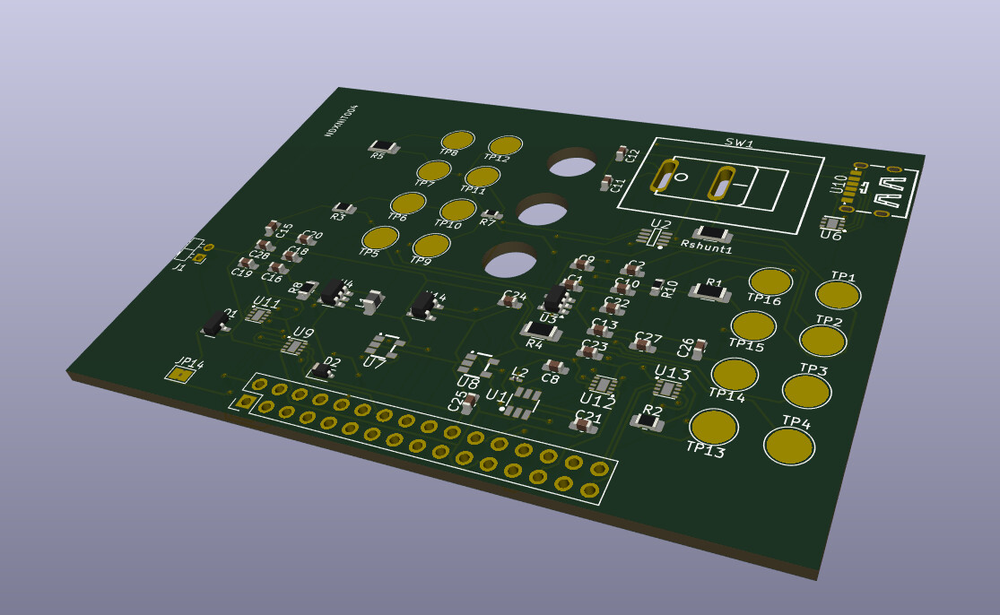
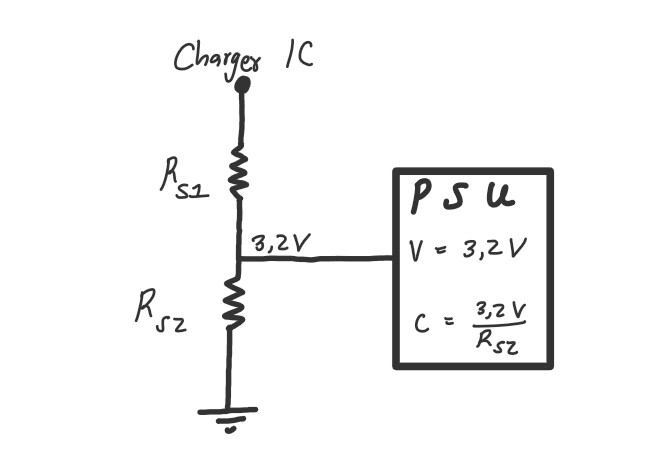

# micromouse-power-subsystem

Power board for a micromouse robot: a two-layer 82 × 60 mm PCB that charges a single-cell LiPo from USB-C at two selectable currents, makes regulated 3.3 V and 5 V rails, switches the robot on and off, drives four brushed motors and two external loads, and monitors the battery over I²C. It plugs into the robot's motherboard through a 2 × 16 header. It was designed in KiCad, fabricated by JLCPCB with most parts assembled there, and tested on the bench for the EEE3088F design course at the University of Cape Town (2025).

*Top side, rendered from the Gerber files that were sent to JLCPCB. The battery connector J1 is on the left, the USB-C port and power switch SW1 top right, and the 2 × 16 motherboard header along the bottom.*

## Who did what

This was a pair project, and the eight requirements were split evenly. **My half** is the charging path and the supply rails: the 9 V to 6 V buck converter, the battery charger with its two charge currents, the 3.3 V regulator, the 5 V boost converter and the ON/OFF switch. My partner designed USB-C power delivery, the motor drivers, the battery monitor and the load switches. We laid out and tested the board together. The design decisions and test results below are from my individual report ([docs/EEE3088F_report.pdf](docs/EEE3088F_report.pdf)).

## Design

| Block | Choice | Why |
|---|---|---|
| Charger input | MT2492 buck, 9 V to 6 V (feedback 100 kΩ / 11 kΩ) | The MCP73831 accepts at most 6 V, and a buck wastes far less than a resistor divider |
| Charger | MCP73831-2-OT | Simple linear charger, charge current set by one resistor, in stock at JLCPCB. Chosen over the TP4056 and FM4057 |
| Two charge currents | R_PROG of 5 kΩ (about 200 mA) or 2 kΩ (about 500 mA), with an AO3400A MOSFET shorting the 3 kΩ part | A MOSFET gate draws no current and its on-resistance is small and stable, unlike a BJT's saturation voltage |
| 3.3 V rail | AP2112K-3.3 LDO | 600 mA rating against a 300 mA spec, 55 µA quiescent current, cheapest of the three options compared |
| 5 V rail | MT3608 boost, output 0.6 V × (1 + 110 kΩ / 15 kΩ) = 5.0 V | 2 A capability against a 1.5 A spec, cheap, in stock |
| ON/OFF | Mechanical SPST switch between the battery and the system rails | The charger stays on the raw battery, so the robot can charge while it is switched off |
| Debugging | 16 test points, SOT packages with exposed leads, a jumper to bypass the charge-mode MOSFET | Every rail and IC input can be probed or driven by hand after assembly |

*The schematic sheet for my half, with the 2 × 16 header pinout in the middle.*

## Test results

Measured on the assembled board with a multimeter, a bench supply and resistor loads. To test charging without risking a real LiPo, the charger output was connected to a "simulated battery": a 1 Ω series resistor into a node held at 3.2 V by a bench supply, with a load resistor sized for the target current.

| Test | Specification | Measured | Result |
|---|---|---|---|
| AT01 Charging input | 9 V ± 0.5 V | HV 9.05 V, buck output 6.025 V, charger output 4.15 V | Pass |
| AT02 Slow charge | 200 mA ± 20 mA | About 202 mA into the simulated battery | Pass |
| AT03 Fast charge | 600 mA ± 100 mA | 330 mA (R_PROG switched from 5 kΩ to 2 kΩ as designed) | **Fail** |
| AT04 3.3 V output | 3.3 V ± 5 % | 3.31 V | Pass |
| AT05 3.3 V current | 300 mA | 327 mA into 10 Ω, 0.75 mA into 5 kΩ | Pass |
| AT06 5 V output | 5 V ± 5 % | 5.05 V | Pass |
| AT07 5 V current | 1.5 A | 1.0 A into 3.33 Ω | **Fail** |
| AT08 OFF-state current | Under 30 µA | No measurement recorded | Not shown |
| AT09 Peak battery current | 2 A with the switch ON | Not reached | **Fail** |

*Left: the KiCad 3D view. Right: the simulated battery used for AT02 and AT03.*

### Why the high-current tests failed

In the report I put all three failures down to the 0.25 mm tracks. Looking at the design again in 2026, there are two separate problems, and the charger one is mostly not about tracks.

- **The fast-charge mode could not have reached 600 mA.** The MCP73831 is rated for 500 mA at most, and R_PROG = 2 kΩ sets exactly 500 mA, the bottom edge of the 600 ± 100 mA window. Feeding it 6 V makes things worse. A linear charger burns (V_in − V_bat) × I, which is (6.0 − 3.2) V × 0.5 A ≈ 1.4 W in a SOT-23-5 package. The MCP73831 reduces its current when the die gets hot, and at the measured 330 mA it was already dissipating about 0.9 W. Thermal regulation is the most likely reason for 330 mA. I did not measure the die temperature, so this is an estimate. A charger rated above 1 A, fed from about 5 V, would fix it.
- **The board has no copper pours.** Every track is 0.25 mm wide, including GND (367 mm of track), the battery net (266 mm), HV and 5 V. Assuming 1 oz copper, 0.25 mm is about 2 mΩ per mm. Delivering 1.5 A at 5 V needs about 2.2 A from the battery, so every 50 mm of path drops about 0.2 V and heats the track. That limits the 5 V rail and the 2 A peak. Tracks over 1 mm wide for the battery, HV and 5 V, and a ground pour on the bottom layer, would remove most of it. The autorouter laid out these tracks, and routing the power nets by hand would have caught it.

## Limits

- **Tests incomplete:** the report records no measurement for the OFF-state current (AT08) and no number for the 2 A peak (AT09).
- **No battery protection:** nothing on the board stops the LiPo discharging below 3 V. The MT3608 keeps drawing current until the battery is flat.
- **Charging tested on a simulated battery only:** charging was tested with the simulated battery described above, not a real LiPo, so charge termination and the full charge cycle were not checked.
- **Old simulation:** `simulations/fast_charge.asc` is an early LTspice model of the charge-current switch with a 2N2222 BJT. The board uses an AO3400A MOSFET.
- **Not my half:** I only describe the parts I designed. The motor drivers, battery monitor, USB-C and load switches are my partner's work.

## Open the design

The files need **KiCad 9** or later. Open `hardware/MM_power_subsystem.kicad_pro`. Custom footprints are in `hardware/Library.pretty` and the custom symbol in `hardware/MM_library.kicad_sym`, both referenced relative to the project.

| Path | Holds |
|---|---|
| `hardware/` | KiCad project, schematic, PCB and custom libraries |
| `fabrication/gerber/` | Gerber and drill files as sent to JLCPCB |
| `fabrication/BOM-*.csv`, `CPL-*.csv` | Bill of materials (LCSC part numbers) and placement file for JLCPCB assembly |
| `simulations/` | Early LTspice model of the charge-current switch |
| `docs/` | Images and the individual design report |
